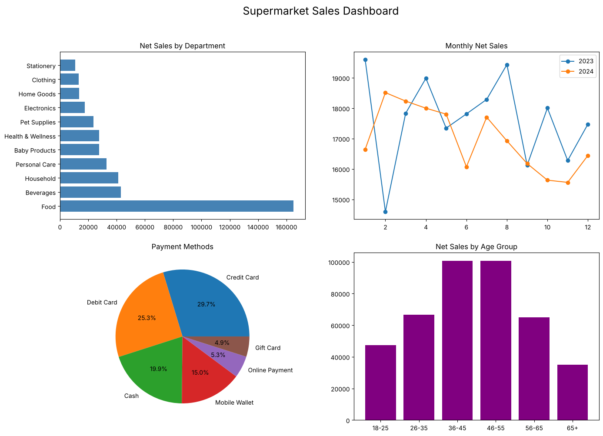
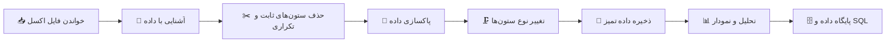
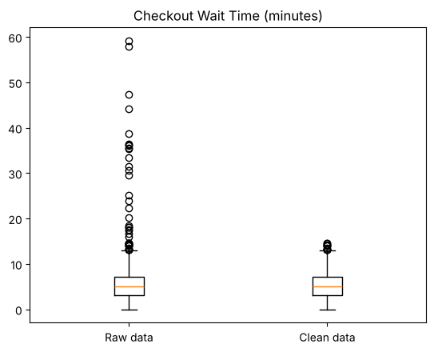
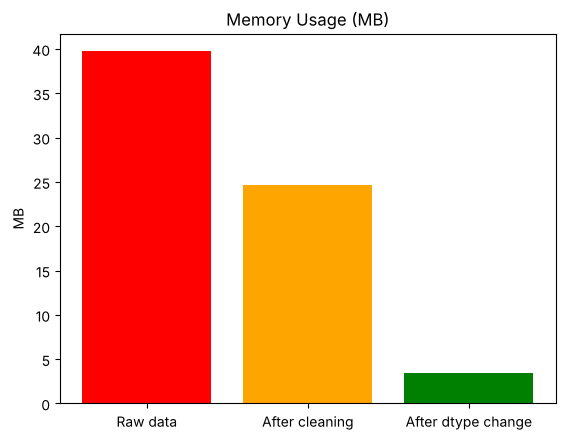
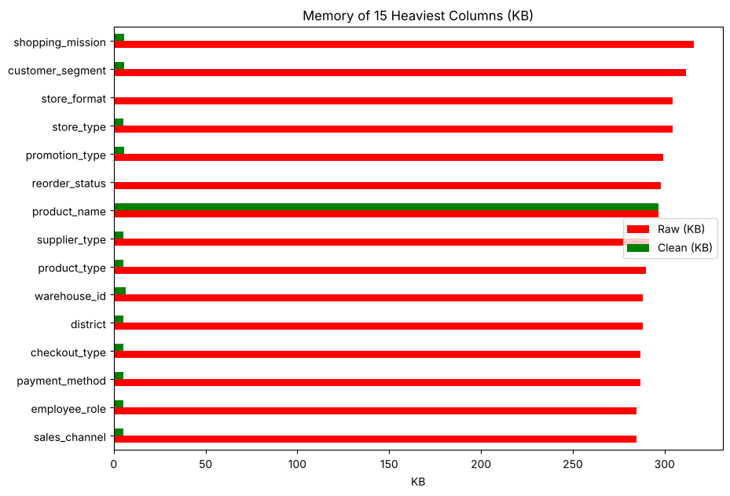
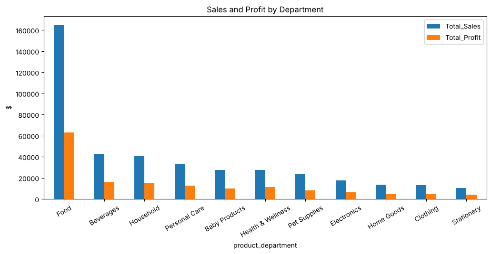
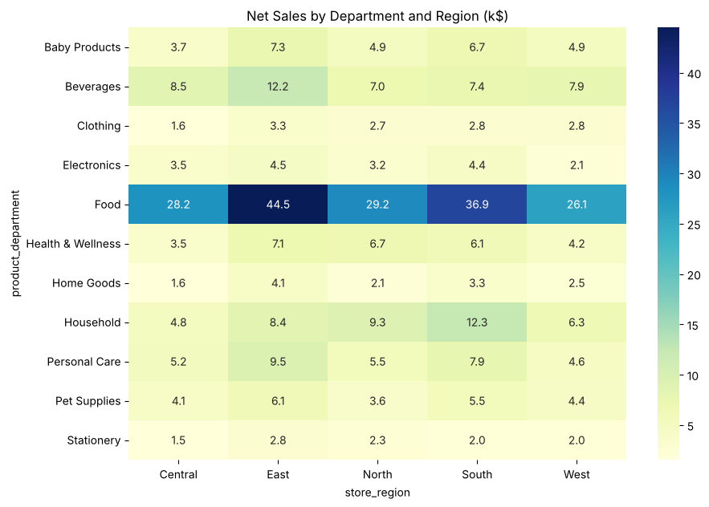
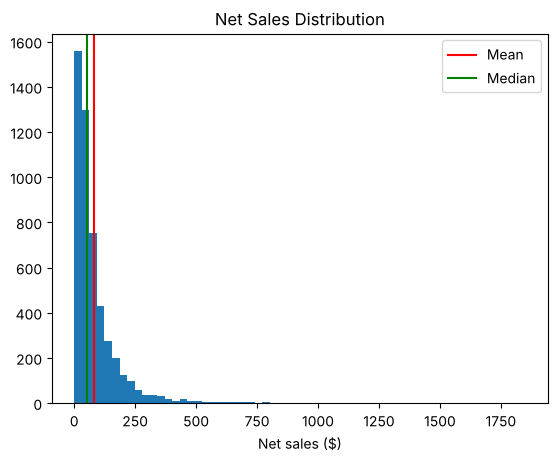
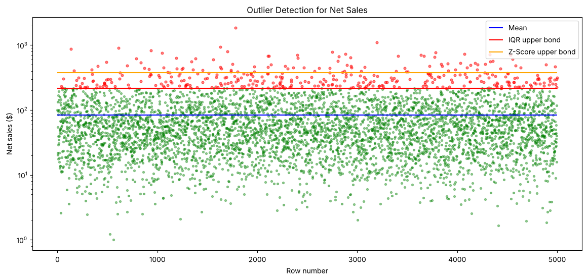
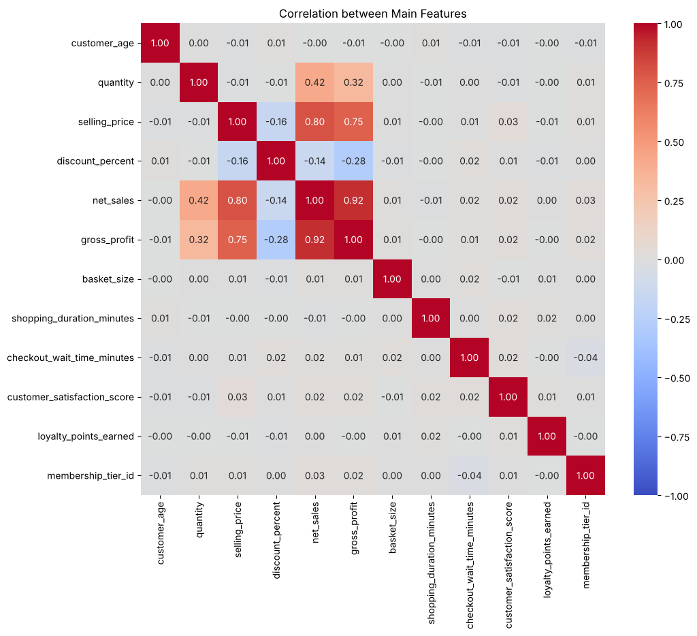

<div align="center">

# 🛒 تحلیل داده‌های فروش سوپرمارکت

**پاکسازی، کاهش حجم و تحلیل اکتشافی یک داده واقعی ۳۱۵ ستونی با پایتون**

[](https://www.python.org/)
[](https://pandas.pydata.org/)
[](https://numpy.org/)
[](https://scikit-learn.org/)
[](https://www.sqlalchemy.org/)
[](Supermarket_Project.ipynb)

[](https://colab.research.google.com/github/hamed-py/supermarket-data-analysis/blob/main/Supermarket_Project.ipynb)



</div>

<div dir="rtl">

## 📌 درباره پروژه

این مخزن پروژه پایانی درس **تحلیل داده** است. داده پروژه، تراکنش‌های فروش یک سوپرمارکت در سال‌های ۲۰۲۳ و ۲۰۲۴ است که هر ردیف آن یک تراکنش با **۳۱۵ ستون** اطلاعات است: مشتری، فروشگاه، کالا، قیمت، تخفیف، زمان، پرداخت، انبار، تأمین‌کننده، ارسال، رضایت مشتری، آب‌وهوا و وضعیت اقتصادی.

هدف پروژه این است که این داده بزرگ و نامرتب، قدم‌به‌قدم **تمیز**، **سبک** و **قابل تحلیل** شود و بعد سؤال‌های اصلی کسب‌وکار درباره فروش، سود و رفتار مشتری‌ها جواب داده شوند.

> [!IMPORTANT]
> **داده این مخزن یک نمونه کوچک است.** فایل `supermarket_data.xlsx` فقط **۵۰۰۰ ردیف** از داده اصلی پروژه را دارد و برای این در مخزن قرار گرفته که حجم آن کم باشد و پروژه سریع اجرا و بررسی شود. داده اصلی خیلی بزرگ‌تر است و کد نوت‌بوک باید روی آن هم اجرا و تست شود. کدها طوری نوشته شده‌اند که بدون هیچ تغییری روی داده کامل هم کار کنند؛ فقط کافی است فایل کامل با همان نام `supermarket_data.xlsx` کنار نوت‌بوک قرار بگیرد.

> **نکته:** همه کدها بدون تعریف تابع و کلاس، با همان روش‌ها و دستورهایی نوشته شده‌اند که در کلاس آموزش داده شد. هر سلول یک کار مشخص انجام می‌دهد و توضیح فارسی هر مرحله در سلول‌های متنی نوت‌بوک آمده است.

## 📑 فهرست

- [نتایج کلیدی](#-نتایج-کلیدی)
- [مراحل پروژه](#-مراحل-پروژه)
- [پاکسازی داده](#-پاکسازی-داده)
- [کاهش حجم داده](#-کاهش-حجم-داده)
- [تحلیل‌ها و نمودارها](#-تحلیلها-و-نمودارها)
- [ساختار مخزن](#-ساختار-مخزن)
- [اجرای پروژه](#-اجرای-پروژه)
- [کتابخانه‌ها](#-کتابخانهها)

## 🏆 نتایج کلیدی

| شاخص | داده خام | داده تمیز |
|:---|:---:|:---:|
| تعداد ردیف | ۴٬۹۹۹ | ۴٬۹۹۹ |
| تعداد ستون | ۳۱۵ | ۲۷۹ |
| حجم داده در حافظه | ۳۹٫۷ مگابایت | **۳٫۵ مگابایت** |
| مقادیر خالی | ۴۶٬۸۰۵ | **۰** |
| ردیف‌های خراب | ۴۱ | **۰** |

- 📉 **کاهش ۹۱ درصدی حجم داده** با حذف ستون‌های اضافی و انتخاب کوچک‌ترین نوع داده برای هر ستون
- 🔍 **پیدا کردن و اصلاح ۴۱ ردیف خراب** که خطای آن‌ها در چند ستون مختلف پخش شده بود
- 🧹 **پر کردن ۴۶٬۸۰۵ مقدار خالی** با توجه به معنی هر ستون
- 📊 **بیش از ۳۰ نمودار و جدول تحلیلی** درباره فروش، سود، زمان، مشتری، تبلیغات و پرداخت

> [!NOTE]
> اعداد این جدول و همه نمودارهای این صفحه از اجرای نوت‌بوک روی **نمونه ۵۰۰۰ ردیفی** به دست آمده‌اند. با اجرای نوت‌بوک روی داده اصلی، عددها تغییر می‌کنند ولی مراحل کار و روش‌ها همین است.

## 🧭 مراحل پروژه

</div>



<div dir="rtl">

| بخش | موضوع | ابزارهای اصلی |
|:---:|:---|:---|
| ۱ و ۲ | خواندن و آشنایی با داده | `read_excel`، `info`، `describe`، `isna`، `nunique` |
| ۳ | حذف ستون‌های ثابت و تکراری | `nunique`، `T.duplicated`، `equals`، `drop` |
| ۴ | پاکسازی داده | `loc`، `fillna`، `map`، `str.strip`، مجموعه‌ها |
| ۵ | کاهش حجم حافظه | `category`، `int8`، `int16`، `float32` |
| ۶ | ذخیره داده تمیز | `to_csv` |
| ۷ و ۸ | آمار توصیفی و توزیع | میانگین، میانه، مد، انحراف معیار، چولگی، `hist` |
| ۹ | داده‌های پرت | روش انحراف معیار، دامنه میان‌چارکی، `boxplot`، `violinplot` |
| ۱۰ تا ۱۴ | تحلیل فروش و سود | `groupby`، `pivot_table`، `heatmap`، `pie` |
| ۱۵ | جدا کردن و ادغام جدول‌ها | `merge` (inner، left، outer) |
| ۱۶ | عملیات نامپای | `split`، `vstack`، `c_`، `clip`، `where`، `unique` |
| ۱۷ | کدگذاری و همبستگی | `map`، `LabelEncoder`، `OneHotEncoder`، `corr`، `pairplot` |
| ۱۸ و ۱۹ | تحلیل متن و شباهت | `CountVectorizer`، `cosine_similarity`، `jaccard` |
| ۲۰ | پایگاه داده | `SQLAlchemy`، `to_sql`، `read_sql`، `sqlite3` |
| ۲۱ | جمع‌بندی و داشبورد | `subplots` |

## 🧹 پاکسازی داده

### ردیف‌های خراب

دو ستون `quantity` و `quantity_sold` هر دو تعداد کالای فروخته‌شده را نشان می‌دهند، ولی در **۴۱ ردیف** مقدار `quantity` سه تا هفت برابر مقدار واقعی ثبت شده بود. با بررسی رابطه‌های حسابی بین ستون‌ها مشخص شد که همین خطا فروش خالص، مبلغ نهایی، ارزش سبد خرید و زمان انتظار در صف را هم خراب کرده است:

| رابطه | ردیف‌های سالم | ردیف‌های خراب |
|:---|:---:|:---:|
| `net_sales = sales_revenue` | ۱۰۰٪ | ۰٪ |
| `sales_revenue = quantity_sold × price` | ۱۰۰٪ | ۱۰۰٪ |
| `tax = sales_revenue × rate` | ۱۰۰٪ | ۱۰۰٪ |

مقدارهای غلط از روی ستون‌های درست دوباره حساب شدند:

<div align="center">

</div>

### مقادیر خالی

| نوع مقدار خالی | مثال | روش پر کردن |
|:---|:---|:---|
| خالی به معنی «وجود ندارد» | نوع تعطیلی در روز غیرتعطیل | `No Holiday`، `No Promotion`، `No Return` و ... |
| وابسته به ستون دیگر | زمان ارسال برای خرید بدون ارسال به خانه | صفر |
| متنی ثبت‌نشده | تحصیلات مشتری | `Unknown` |
| عددی ثبت‌نشده | امتیاز رضایت مشتری | میانه ستون |

### بررسی‌های منطقی

قیمت فروش بیشتر از قیمت اصلی نباشد، تاریخ تحویل قبل از تاریخ سفارش نباشد، موجودی انبار با تعداد فروش بخواند و ماه و سال با تاریخ تراکنش یکی باشند. سودهای منفی هم بررسی شدند و معلوم شد مربوط به فروش واقعی زیر قیمت خرید هستند، نه خطا.

## 🗜️ کاهش حجم داده

| مرحله | کار انجام‌شده | تعداد ستون |
|:---|:---|:---:|
| حذف ستون‌های ثابت | ستون‌هایی که فقط یک مقدار داشتند (مثل `country`) | ۸ |
| حذف ستون‌های تکراری | ستون‌هایی که دقیقاً برابر ستون دیگری بودند (مثل `store_format`) | ۲۴ |
| حذف ستون‌های زمان اضافی | `transaction_date` و `transaction_time` | ۲ |
| حذف ستون‌های تکراری بعد از اصلاح | `quantity_sold` و `sales_revenue` | ۲ |
| تبدیل بله و خیر | ستون‌های `Yes` و `No` به صفر و یک (`int8`) | ۴۴ |
| تبدیل متن | ستون‌های متنی تکراری به `category` | ۶۵ |
| تبدیل عدد | `int64` به `int8` و `int16` و `float64` به `float32` | ۱۶۲ |

<div align="center">


</div>

## 📊 تحلیل‌ها و نمودارها

### فروش و سود هر بخش کالا

بخش غذایی بیشترین تعداد تراکنش، فروش و سود را دارد.

<div align="center">

</div>

### فروش بر اساس بخش کالا و منطقه

<div align="center">

</div>

### توزیع فروش و داده‌های پرت

فروش هر تراکنش چوله به راست است. داده‌های پرت با دو روش انحراف معیار و دامنه میان‌چارکی پیدا شدند. چون این تراکنش‌ها خرید واقعی کالاهای گران بودند، حذف نشدند و فقط علامت خوردند.

<div align="center">

</div>

<div align="center">

</div>

### همبستگی

مبلغ خرید بیشتر به قیمت و تعداد کالا وابسته است تا به سن مشتری، زمان انتظار یا سطح عضویت.

<div align="center">

</div>

### یافته‌های مهم

- 🥫 **بخش غذایی** به‌تنهایی حدود ۴۰ درصد فروش را دارد.
- 🌅 بیشتر خریدها در **ساعت‌های صبح** انجام می‌شود.
- 🏷️ تخفیف‌ها و تبلیغات باعث **افزایش تعداد خرید نشده‌اند**.
- 👥 گروه‌های مختلف مشتری سبد خرید **تقریباً مشابهی** دارند (شباهت کسینوسی بالای ۰٫۹۹).
- 💳 کارت اعتباری و کارت بانکی پرکاربردترین روش‌های پرداخت هستند.

## 📁 ساختار مخزن

</div>

```text
supermarket-data-analysis/
├── Supermarket_Project.ipynb    # نوت‌بوک اصلی پروژه همراه با خروجی‌ها
├── supermarket_data.xlsx        # نمونه ۵۰۰۰ ردیفی از داده اصلی
├── outputs/
│   ├── supermarket_clean.csv    # داده تمیزشده
│   └── supermarket.db           # پایگاه داده SQLite
├── images/                      # نمودارهای استفاده‌شده در همین صفحه
├── requirements.txt             # کتابخانه‌های لازم
└── README.md
```

<div dir="rtl">

## 🚀 اجرای پروژه

### روش اول: گوگل کولب (پیشنهادی)

1. روی دکمه **Open in Colab** در بالای همین صفحه کلیک کنید.
2. فایل `supermarket_data.xlsx` را از همین مخزن دانلود کنید و از پنل فایل‌های کولب آپلود کنید. برای اجرا روی داده کامل، فایل اصلی را با همین نام آپلود کنید.
3. از منوی `Runtime` گزینه `Run all` را بزنید.

### روش دوم: اجرا روی کامپیوتر

</div>

```bash
git clone https://github.com/hamed-py/supermarket-data-analysis.git
cd supermarket-data-analysis
pip install -r requirements.txt
jupyter notebook Supermarket_Project.ipynb
```

<div dir="rtl">

## 📚 کتابخانه‌ها

| کتابخانه | کاربرد در پروژه |
|:---|:---|
| `pandas` | خواندن، پاکسازی، گروه‌بندی و ادغام داده |
| `numpy` | محاسبات آماری و عملیات آرایه‌ای |
| `matplotlib` و `seaborn` | رسم نمودارها |
| `scipy` | محاسبه مد و فاصله جاکارد |
| `scikit-learn` | کدگذاری داده، تحلیل متن و محاسبه شباهت |
| `sqlalchemy` و `sqlite3` | ذخیره داده در پایگاه داده و گزارش‌گیری با SQL |
| `openpyxl` | خواندن فایل اکسل |

## 👤 نویسنده

**حامد بهرامی گلستانی**

پروژه پایانی درس تحلیل داده

[](https://github.com/hamed-py)

</div>
